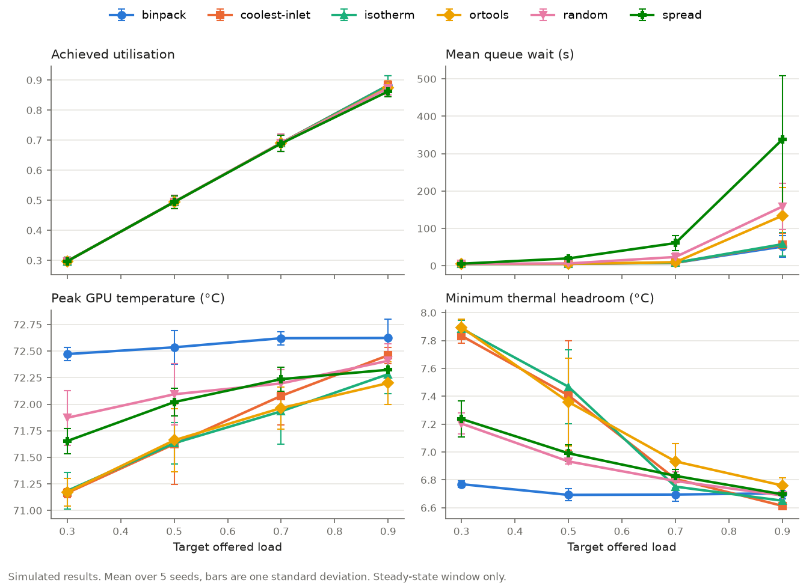

# Isotherm

Thermal-aware GPU scheduling. A kube-scheduler plugin (Go) asks a rack-row thermal
simulator (Python) how hot the row would get for each candidate node, and places pods
where the margin to the thermal limits is largest.

```
isotherm/
  proto/          isotherm.proto: the only contract between components
  configs/        rack.yaml, gpu_specs.yaml: the single source of truth for the physical row
  sim/            thermal simulator: physics/, surrogate/, server.py, tests/
  scheduler/      Go kube-scheduler plugin: cmd/, pkg/plugin/, tests
  replay/         trace loader and pod replayer (drives the kwok cluster and the sim clock)
  experiments/    baseline policies, OR-Tools batch placement, plots
  ml/             surrogate dataset generation (from the sim's rollout oracle) and training
  deploy/         kwok node generator, scheduler config, compose, Prometheus, Grafana
  data/           traces, datasets, models (gitignored)
  docs/           design.md, assumptions.md, results/
```

## Results v1 (simulated)

Every number here is simulated: 6 policies x 4 target loads x 5 seeds = 120 runs of
2,000-job synthetic traces on a 320-GPU row with 18°C supply air. The commands, a snapshot
of the configs and the full per-load tables are in
[docs/results/v1_supply18/](docs/results/v1_supply18/README.md).



Paired differences, isotherm minus the other policy on the same trace (same load and seed).
Each cell is the mean ± standard deviation over 5 seeds, then the number of seeds where
isotherm was lower. A gap smaller than its standard deviation is reported as no difference.

| Isotherm vs | Peak GPU at 30% load (°C) | Peak GPU at 90% load (°C) | Mean busy GPU at 30% (°C) | Mean busy GPU at 90% (°C) | Mean wait at 90% (s) |
|---|---|---|---|---|---|
| binpack | -1.29 ± 0.20 (5/5) | -0.34 ± 0.08 (5/5) | -2.97 ± 0.05 (5/5) | -0.16 ± 0.15 (5/5) | +6.4 ± 5.3 (0/5) |
| spread | -0.47 ± 0.15 (5/5) | no difference (-0.04 ± 0.20, 2/5) | -0.60 ± 0.07 (5/5) | -0.25 ± 0.14 (5/5) | -280.4 ± 165.2 (5/5) |
| random | -0.69 ± 0.29 (5/5) | no difference (-0.13 ± 0.25, 4/5) | -0.70 ± 0.10 (5/5) | no difference (-0.10 ± 0.12, 4/5) | -100.8 ± 48.5 (5/5) |
| coolest-inlet | no difference (+0.02 ± 0.17, 3/5) | no difference (-0.18 ± 0.19, 4/5) | -0.32 ± 0.03 (5/5) | no difference (-0.02 ± 0.03, 3/5) | no difference (+1.4 ± 1.7, 1/5) |
| ortools | no difference (+0.01 ± 0.14, 4/5) | no difference (+0.08 ± 0.11, 1/5) | -0.21 ± 0.07 (5/5) | no difference (+0.06 ± 0.17, 2/5) | -76.2 ± 58.8 (5/5) |

Isotherm keeps the hottest GPU 1.29°C cooler than binpack at 30% load and 0.34°C cooler at
90% load (5 of 5 seeds at every load), and the gap shrinks as the row fills because fewer
cool places are left to choose from. Against the cheap coolest-inlet rule the peak GPU
temperature is a tie at every load, and no run came near a limit (zero throttling, peak
inlet 20.4°C against a 27°C limit, peak GPU 72.8°C against throttle temperatures of 85°C
and 87°C), so this sweep cannot show whether predicting ahead is worth its cost.

## Prerequisites

- [uv](https://docs.astral.sh/uv/) (Python envs; one per component)
- Go 1.23+ and `protoc` for the scheduler (`brew install go protobuf`)
- Optional: Docker, [kwok/kwokctl](https://kwok.sigs.k8s.io/) and kubectl for the cluster workflow

## Quick start

```bash
make setup            # install every component's deps + Go protoc plugins
make proto            # generate stubs from proto/isotherm.proto
make test             # each component's lint + tests, one after another

make sim              # terminal 1: simulator on :50051, Prometheus metrics on :9100
make trace            # synthetic trace -> data/synthetic.csv
make baselines        # every policy vs the sim -> docs/results/baselines.csv + plots

make sim METRICS_PORT=0   # for sweeps: no Prometheus refresh on every step (faster)
make sweep-traces     # 2,000-job traces at LOADS="0.3 0.5 0.7 0.9" x 5 seeds -> data/sweep/
make sweep            # every policy, steady-state metrics -> docs/results/sweep*.csv + plot
```

Train the learned surrogate (the rollout oracle provides the labels):

```bash
make dataset && make train && make sim-learned
```

Full Kubernetes path (kwok fakes the nodes, so nothing actually runs):

```bash
make cluster-up       # kwok cluster + one fake node per server in configs/rack.yaml
make sim              # terminal 1
make scheduler        # terminal 2: isotherm-scheduler alongside default-scheduler
make replay           # terminal 3: replay the trace through isotherm-scheduler
SCHEDULER=default-scheduler make replay   # baseline run on the same cluster
```

Dashboards: `make up` starts the sim with Prometheus and Grafana (http://localhost:3000).

`make help` lists every target.

## Changing things

| You want to... | Do this |
|---|---|
| Change the row or the GPUs | Edit `configs/`, then update the matching rows in `docs/assumptions.md`. |
| Change the contract | Edit `proto/isotherm.proto` (add fields; don't renumber), run `make proto` and `make test`. |
| Change the physics | Only in `sim/physics/`. If surrogate inputs change, bump `FEATURE_SCHEMA` in `sim/surrogate/features.py` and retrain. |
| Bump Kubernetes | `make pin-k8s K8S_VERSION=1.31.x`. Note that the framework API changes in 1.34+. |
